# Auto Samplerate Changer for Android (with Optional Bitperfect)

**Your music. Your DAC. No unnecessary resampling.**

**Download:** go to the [Releases page](../../releases), open the newest version at the top, and download the `.zip` under **Assets**. Then follow the [Quick start](#quick-start).

A root module (APatch, KernelSU, Magisk) that makes Android play music through a **USB DAC at each track's own sample rate** instead of resampling everything to one fixed rate. It follows the playing track automatically, can pause the player for a moment while the rate changes, and comes with a **WebUI** and terminal tools so you can see what Android is really doing.

> **Hobby project, best-effort support.** Maintained by **ArupEn1** ([GitHub](https://github.com/ArupEn1)) in spare time, for free, with no income and no promises. It works on the devices listed below; everything else is untested. Issues are welcome, but replies and fixes happen when time allows. Use it at your own risk and read [Before you install](#before-you-install).

## Acknowledgements

I'll be honest: this module is stitched together with a lot of AI assistance, and it would not have been possible without two amazing projects that did the hard parts first.

- **[USB_SampleRate_Changer](https://github.com/yzyhk904/USB_SampleRate_Changer) by zyhk.** This is the heart of the module. It does the real audio-policy work, and his script is included here completely unmodified.
- **[BitPerfect-DAC](https://github.com/varunpilankar/BitPerfect-DAC) by varunpilankar.** The `bp*` tools (`bpstatus`, `bpcheck` and the rest) come from his module, which is where this project started.

Without the two of them this would have been impossible, so a huge thank you. If this module helps you, please go and give their projects a star too.

## Who it is for

Rooted phones or tablets with an **external USB DAC** where the music app's output ends up resampled (for example Apple Music at 96 kHz played as 48 kHz, or a mixer pinned at the DAC's maximum rate).

## What it does

- **Auto-follow:** a small daemon watches the playing track and switches the USB mixer to its sample rate (44.1 / 48 / 88.2 / 96 / 176.4 / 192 kHz).
- **Pause while switching (optional):** pauses the player just before the switch and resumes right after, so the first moments are not played at the wrong rate.
- **WebUI:** every setting as a button or switch, live status, logs and a one-tap sanitized report. Themes: Auto, Day, Night, Retro paper and Retro night, with an animation on/off switch.
- **Truth tools:** `bpstatus` shows mixer rate, source rate, bit depth, digital gain, enabled effects and a `rate-matched` / `RESAMPLED` verdict.
- **Boot apply and reset:** re-applies your mode at boot; `bprate reset` removes the policy overlay and turns the automation off.

### What it does not do

- Prove bit-perfect output from inside Android. The module makes Android play each track at its own sample rate, but whether the samples stay untouched also depends on the app (its volume, effects and DRM), and the phone cannot check that for you.
- Work on the 3.5 mm jack (tested on an LG V30: the jack path is fixed at 48 kHz / 16-bit).
- Fix volume or effects inside the music app, or enabled system effects ("Volume listener" and similar).
- Guarantee Hi-Res delivery; that depends on the service, subscription, track and DAC.
- Give one app exclusive access to the DAC. Android mixes every app into one stream at one rate. The module only switches the rate when exactly one track is playing; if several tracks are active at once it leaves the rate alone, so something may be resampled until only one is left.

## Screenshots

<table>
<tr><td align="center"><a href="docs/screenshots/01.jpg">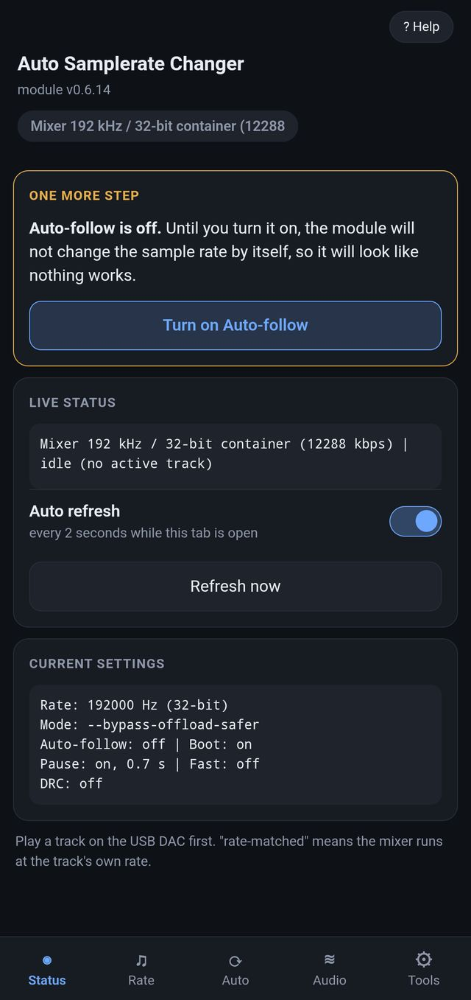</a> First run: Auto-follow nudge</td><td align="center"><a href="docs/screenshots/02.jpg">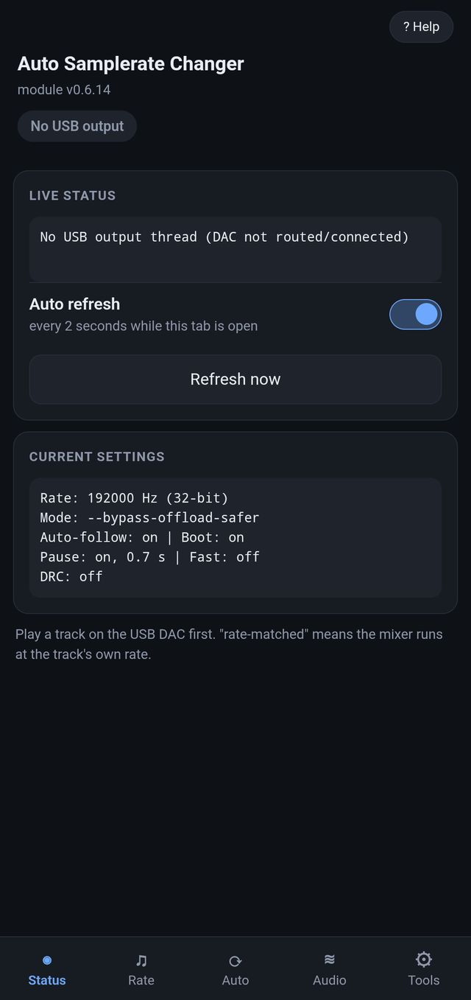</a> No USB output</td><td align="center"><a href="docs/screenshots/03.jpg">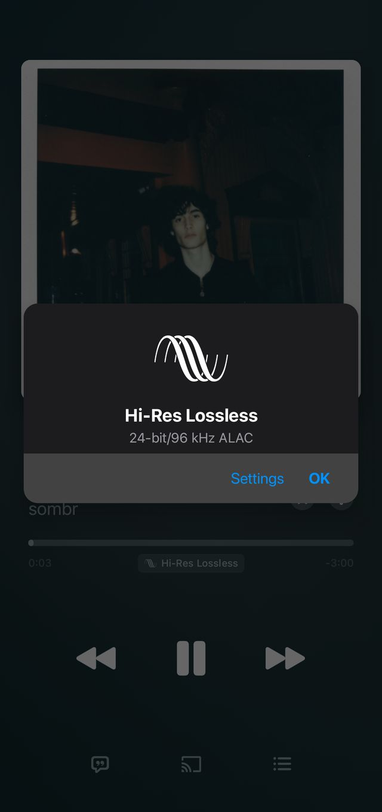</a> Apple Music, 96 kHz track</td><td align="center"><a href="docs/screenshots/04.jpg">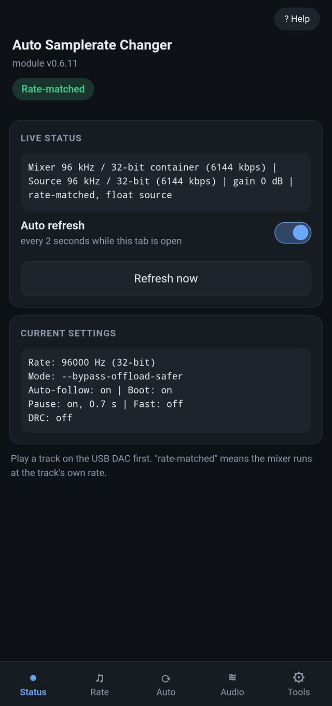</a> Status, 96 kHz rate-matched</td></tr>
<tr><td align="center"><a href="docs/screenshots/05.jpg">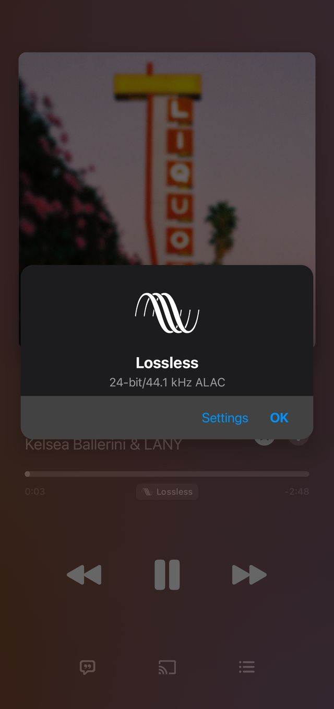</a> Apple Music, 44.1 kHz track</td><td align="center"><a href="docs/screenshots/06.jpg">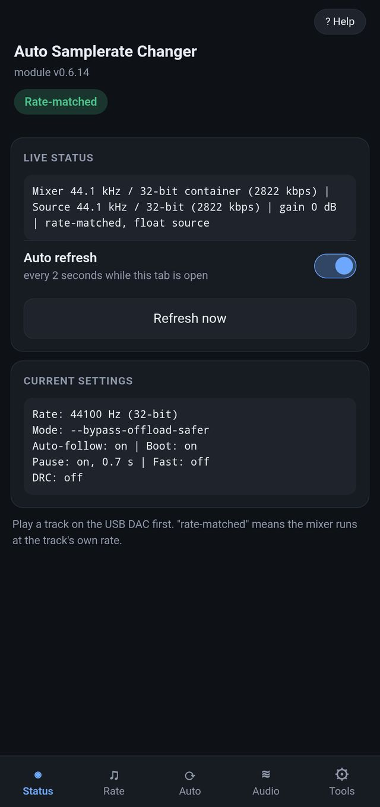</a> Status, 44.1 kHz rate-matched</td><td align="center"><a href="docs/screenshots/07.jpg">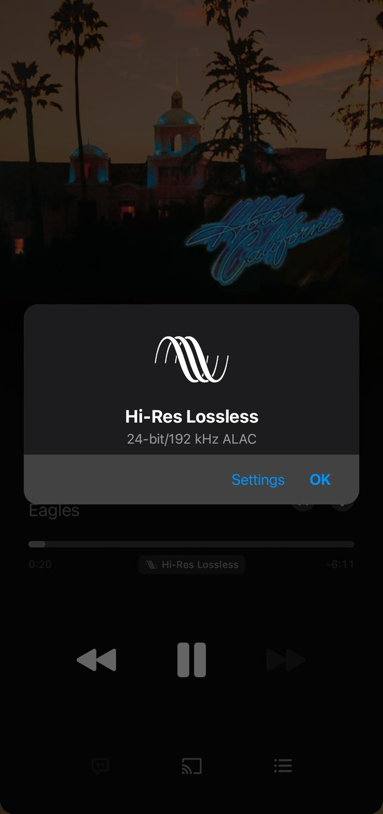</a> Apple Music, 192 kHz track</td><td align="center"><a href="docs/screenshots/08.jpg">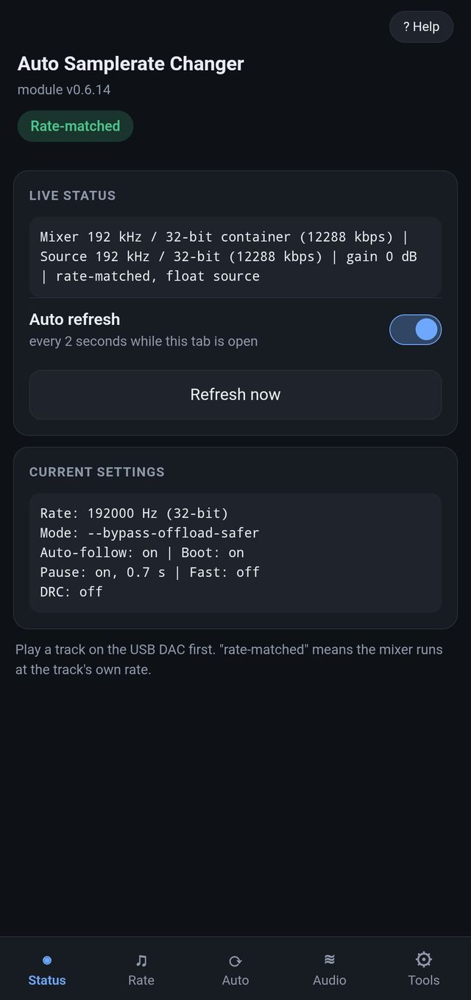</a> Status, 192 kHz rate-matched</td></tr>
<tr><td align="center"><a href="docs/screenshots/09.jpg">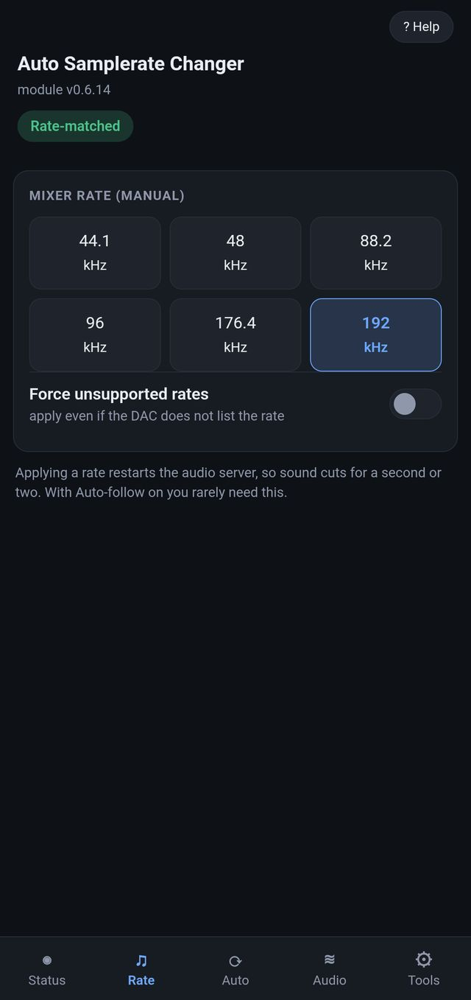</a> Rate tab</td><td align="center"><a href="docs/screenshots/10.jpg">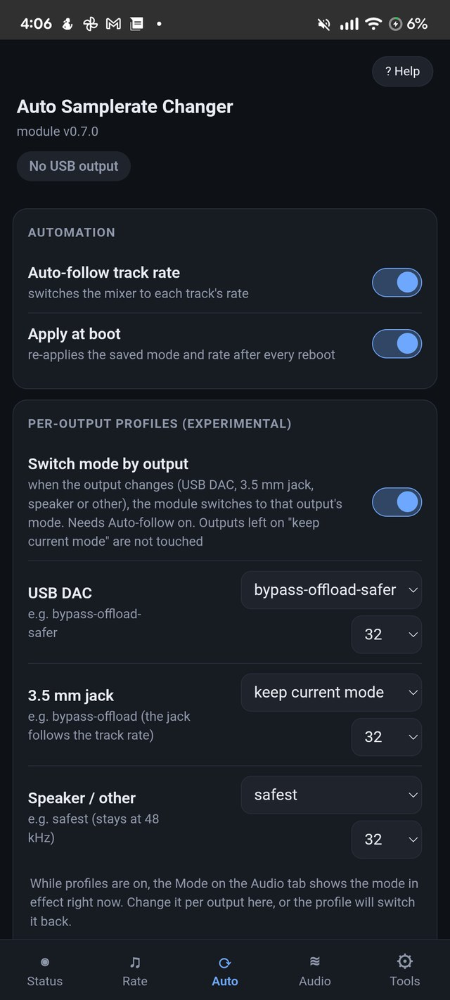</a> Auto tab</td><td align="center"><a href="docs/screenshots/11.jpg">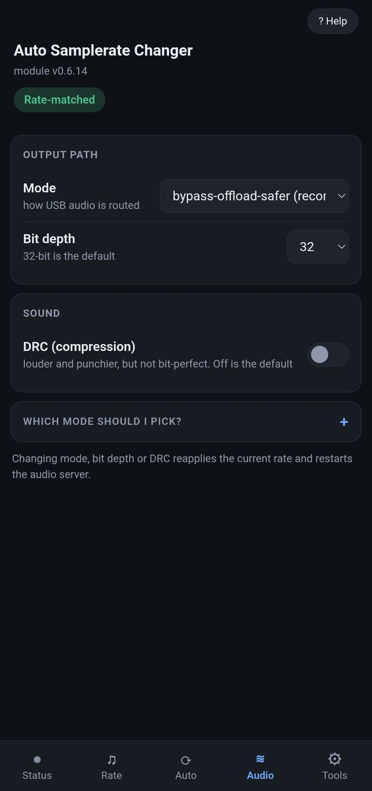</a> Audio tab</td><td align="center"><a href="docs/screenshots/12.jpg">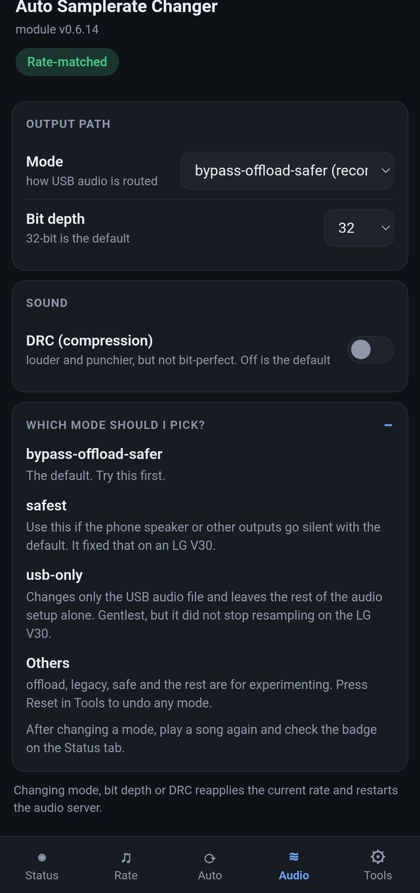</a> Audio: which mode should I pick</td></tr>
<tr><td align="center"><a href="docs/screenshots/13.jpg">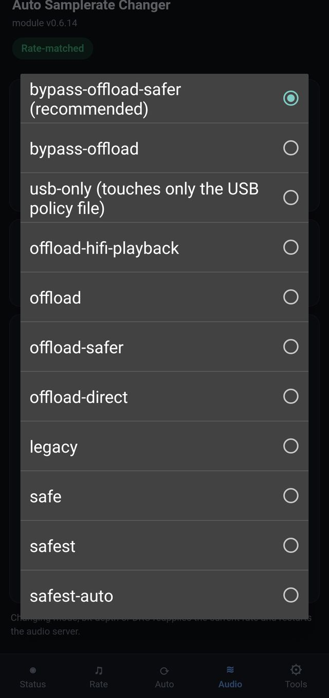</a> Audio: mode list</td><td align="center"><a href="docs/screenshots/14.jpg">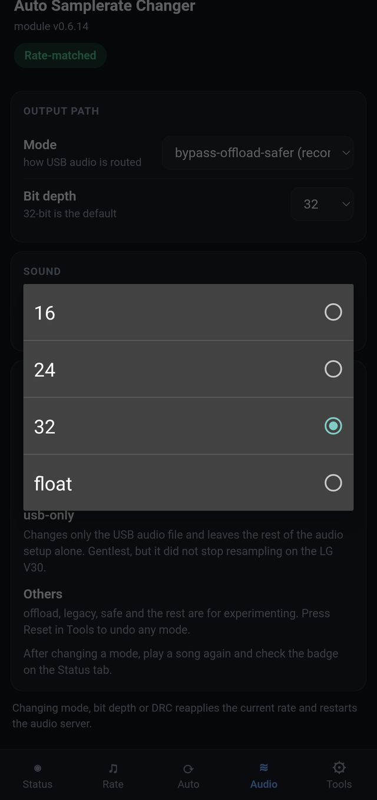</a> Audio: bit depth list</td><td align="center"><a href="docs/screenshots/15.jpg">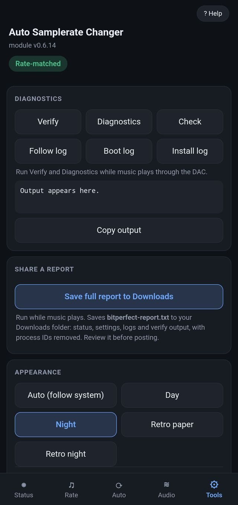</a> Tools, Night theme</td><td align="center"><a href="docs/screenshots/16.jpg">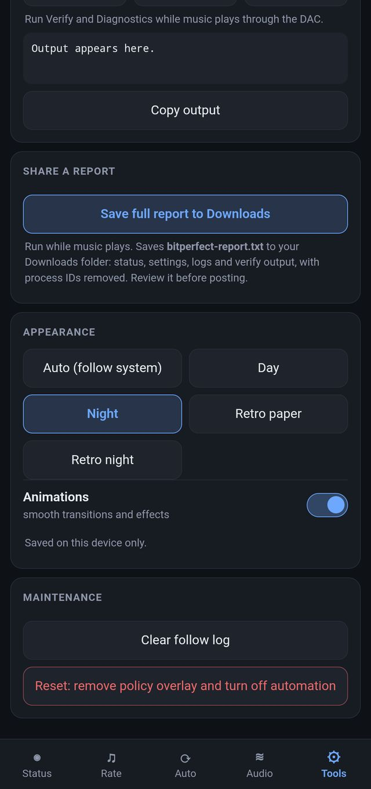</a> Tools: diagnostics and report</td></tr>
<tr><td align="center"><a href="docs/screenshots/17.jpg">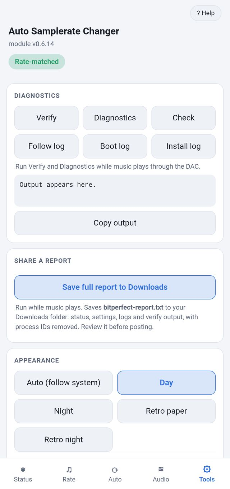</a> Day theme</td><td align="center"><a href="docs/screenshots/18.jpg">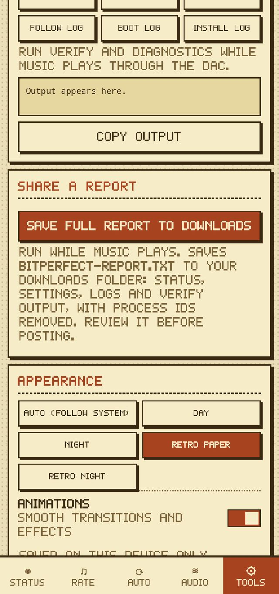</a> Retro paper theme</td><td align="center"><a href="docs/screenshots/19.jpg">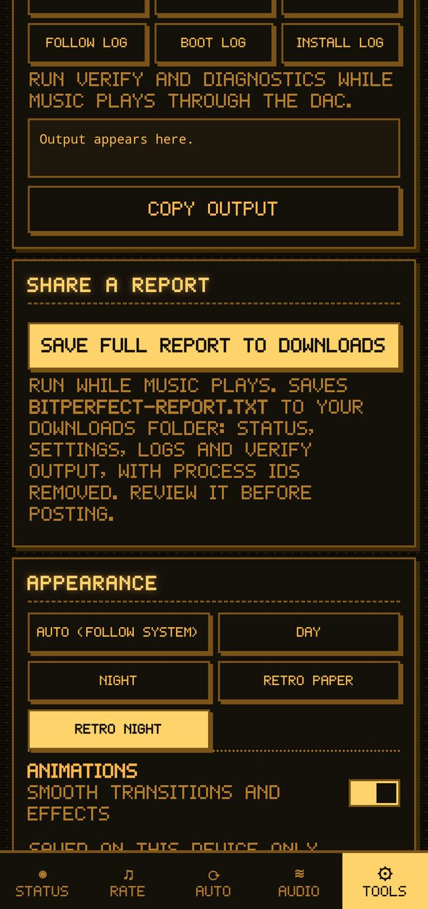</a> Retro night theme</td><td align="center"><a href="docs/screenshots/20.jpg">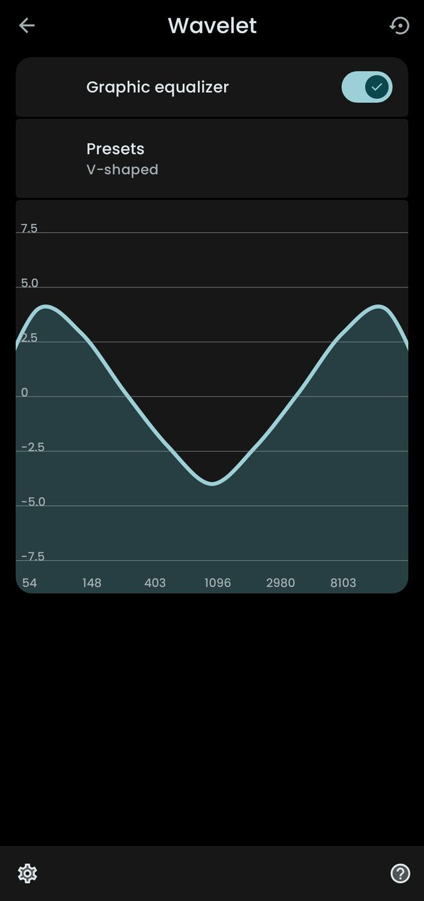</a> Wavelet equalizer on</td></tr>
<tr><td align="center"><a href="docs/screenshots/21.jpg">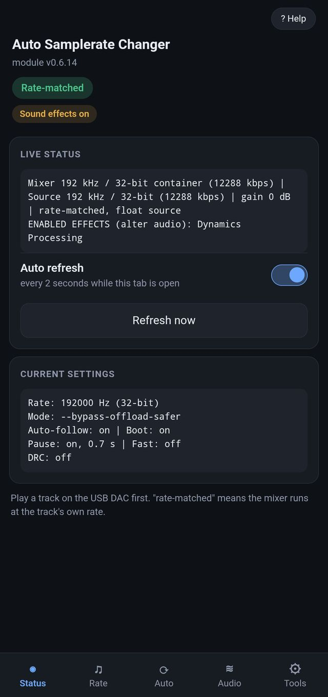</a> Status with sound effects on</td><td align="center"><a href="docs/screenshots/22.jpg">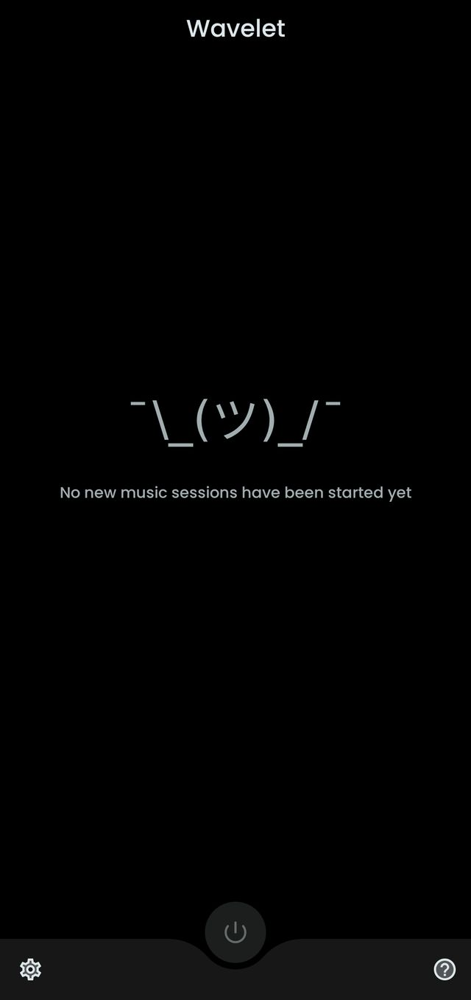</a> Wavelet idle, nothing applied</td><td align="center"> Status, 192 kHz clean</td></tr>
</table>

Tap an image for full size. More in the XDA thread: XDA_LINK_HERE

## How it knows the track's sample rate

It does not read the player's metadata. The follower polls Android's audio server (`dumpsys media.audio_flinger`), finds the active track in the track table and takes the rate that track is opened at, so it follows what is really being played whatever the app claims.

- It polls about every 0.4 s and needs a second poll to confirm a new rate before switching, so a brief glitch does not trigger a restart. The optional fast mode skips the confirmation and polls about every 0.12 s.
- When the rate changes it asks the backend to set the USB mixer to that rate, or to a x2 / x4 / x8 multiple if the DAC does not support it. It then waits for the audio server to come back before carrying on.
- More than 6 switches in 2 minutes turns auto-follow off, and two failed backend calls do the same, so a misbehaving source cannot loop forever.
- In the maintainer's testing with many Apple Music songs, the rate never changed in the middle of a song, so switches happen when a new track starts. A mid-stream rate change (some radio streams, for example) should be caught on the next poll, but it has not been tested.

## How it is built

The audio-policy rewrite is done by the bundled, **unmodified** [USB_SampleRate_Changer](https://github.com/yzyhk904/USB_SampleRate_Changer) by zyhk (AGPL-3.0, license in `module/usbsrc/LICENSE`). This module adds the follower daemon, pause/resume, boot apply, the WebUI and the diagnostic tools. The `bp*` tools come from the GPL-3.0 [BitPerfect-DAC](https://github.com/varunpilankar/BitPerfect-DAC) module by varunpilankar, which this project started from and has changed and extended since; the record is in [docs/HISTORY.md](docs/HISTORY.md) and credits are in [NOTICE](NOTICE).

## Tested setups

| Device | ROM / Android | Root | Result |
|---|---|---|---|
| Moto Edge 30 Fusion | LineageOS 24 / Android 17 | APatch + Hybrid Mount | Works: rate-matched, auto-follow, pause/resume |
| Samsung Galaxy Tab S9 | One UI 7 / Android 15 (R/W) | KernelSU Next + Hybrid Mount | Works (reported) |
| LG V30 | LineageOS 22.2 / Android 15 | Magisk | USB DAC works in `safest` mode; jack not supported |

Details and evidence: [docs/COMPATIBILITY.md](docs/COMPATIBILITY.md). Other devices, ROMs, DACs and apps are **untested**, and Spotify has not been tried.

## Before you install

- You need a **rooted device** and an **external USB DAC**.
- **Mounting:** on KernelSU and APatch, module files (including the `bp*` tools) are made visible by your mount metamodule. The setups above used [Hybrid Mount](https://github.com/Hybrid-Mount/meta-hybrid_mount). If the commands are missing after install, check your mount setup; the WebUI and the module folder work either way.
- **WebUI on Magisk:** Magisk has no built-in WebUI; open it with WebUI X or MMRL.
- **Know how to recover** (safe mode, recovery, or deleting the module folder from a root shell). See [docs/INSTALL.md](docs/INSTALL.md).
- Remove other modules that edit audio policy or effects (HiFi SRC Bypass, NLSound, Ainur Silmaril and similar); they edit the same files.
- For bit-exact / bit-perfect playback, set **media volume to maximum** and turn off EQ, loudness, crossfade and volume normalisation in your music app. An EQ still works if you want one; see [Using an equalizer](#using-an-equalizer-eq-or-parametric-eq).

## Quick start

You only need your phone. No terminal, no typing commands.

### 1. Install
1. Download `Auto-Samplerate-Changer-<version>.zip` from [Releases](../../releases) (the `.sha256` file lets you check it), or build it yourself with `sh scripts/build.sh`.
2. Open your root manager (**Magisk**, **KernelSU** or **APatch**), go to **Modules**, choose **Install from storage** and pick the ZIP.
3. **Reboot** when it finishes.

### 2. Open the WebUI
The WebUI is the module's control panel, with buttons and switches for everything.
- **KernelSU / APatch:** go to **Modules** and tap the WebUI / Open button on this module.
- **Magisk:** Magisk has no built-in WebUI, so install **WebUI X** or **MMRL**, give it root, and open this module from there.

### 3. Turn it on

> **Important: Auto-follow is OFF after installing.** The module does not change sample rates by itself until you switch on **Auto-follow track rate** in the **Auto** tab (step 3 below). If you skip this it will look like nothing works.
1. Plug in your USB DAC and **play a song** in your music app.
2. In the WebUI, look at the **Status** tab. A green **Rate-matched** badge means the music is playing at its own sample rate.
3. **Open the Auto tab and switch on Auto-follow track rate.** Leave **Apply at boot** on too.
4. Play tracks with different sample rates, for example 44.1 kHz and 96 kHz. The rate follows each track by itself. By default the player pauses for a moment while it switches and resumes right after; you can change that on the same tab.

For bit-exact / bit-perfect playback, set the **media volume to maximum** and turn off EQ, loudness and effects in your music app. (An EQ still works if you want one, see below.)

### The WebUI tabs

| Tab | What it is for |
|---|---|
| **Status** | Live status of the audio path, the badge, and your current settings |
| **Rate** | Pick a sample rate by hand (you rarely need this with Auto-follow on) |
| **Auto** | Auto-follow, apply at boot, pause and resume while switching |
| **Audio** | Output mode, bit depth and DRC, with a short guide to picking a mode |
| **Tools** | Checks and logs, the one-tap report for bug reports, and Reset |

The WebUI also has a **? Help** button in the top corner that opens these steps on your phone. You can change the look under **Tools → Appearance** (Auto, Day, Night, Retro and Retro night themes, plus an animations switch).

### If something is wrong
- **No sound, or the speaker went silent:** in the WebUI press **Tools → Reset**, then go to **Audio → Mode** and choose **safest**. This fixed an LG V30.
- **The badge says Resampled:** make sure Auto-follow is on and a song is playing through the DAC, then check the Status tab again. If it stays that way, try another mode on the Audio tab.
- **Still stuck:** open **Tools → Save full report to Downloads** while music is playing, review the file, and attach it to a [GitHub issue](../../issues).

Prefer a terminal? Every command is listed in [docs/TERMINAL.md](docs/TERMINAL.md).

## Using an equalizer (EQ or parametric EQ)

EQ and parametric EQ (the system equalizer, Wavelet and similar apps, or an EQ inside your music app) still work. The module does not disable or bypass effects, and it does not force them off.

- **Resampling is still stopped:** the track keeps playing at its own sample rate.
- **It is no longer bit-exact / bit-perfect while an EQ is on,** because an EQ changes the samples. Turn the EQ off if you want bit-exact / bit-perfect playback.
- Confirmed working by the maintainer; other ROMs and EQ apps may behave differently. `bpstatus` lists any enabled effects, so you can see what is active.

## If tracks above 96 kHz are still resampled

If the WebUI says **Resampled** for a 192 kHz track (for example "Mixer 96 kHz, Source 192 kHz") even though the module asked for 192 kHz, your phone's USB audio driver is probably locked to 96 kHz. The WebUI report then shows the backend warning about the "96kHz lock". Seen on a Moto Edge 30 Fusion (LineageOS 24, `bypass-offload-safer`).

zyhk's separate modules lift that limit:

1. On **APatch**, install [Compatible Magisk-mirroring](https://github.com/Magisk-Modules-Alt-Repo/compatible-magisk-mirroring) first and reboot. Without it, the unlocker's installer stops with "no magisk-mirrors".
2. Install [usb-samplerate-unlocker](https://github.com/Magisk-Modules-Alt-Repo/usb-samplerate-unlocker) and reboot. It patches vendor libraries, so read its page first.
3. In the WebUI, turn **Auto-follow** off and on once so the follower restarts, then play a 192 kHz track.

Confirmed on the Moto above (192 kHz works afterwards); other phones are untested. Details in [docs/COMPATIBILITY.md](docs/COMPATIBILITY.md#rates-above-96-khz-usb-driver-lock).

## Known limitations

- Each rate switch restarts the audio server, so there is a short interruption and the first moments of a track may use the old rate.
- DACs without 88.2 / 176.4 kHz still force resampling for those tracks.
- On some phones the USB audio driver is locked to 96 kHz, so tracks above that stay resampled. See [If tracks above 96 kHz are still resampled](#if-tracks-above-96-khz-are-still-resampled).
- AIDL devices are not supported for now, for example the Samsung Galaxy Z Fold8. Their audio policy comes from the AIDL audio HAL, which is a current limitation of the bundled backend, zyhk's [USB_SampleRate_Changer](https://github.com/yzyhk904/USB_SampleRate_Changer) (it stops with "Recent AIDL only devices are not supported!"). Check with `su -c "dumpsys media.audio_policy | grep -i -A2 'config source'"`: a file path is fine, `AIDL HAL` is not. See [docs/COMPATIBILITY.md](docs/COMPATIBILITY.md#not-supported-aidl-only-audio-hal).
- Digital volume below maximum and enabled effects break bit-exactness. On LG phones the vendor "Volume listener" effect may show up as enabled.
- `bpstatus` confirms Android is playing at the track's own rate. While USB offload is active, Android can't show the final rate sent over USB; a DAC with a display or indicator can confirm the output sampling rate.

## Documentation

| Doc | For |
|---|---|
| [INSTALL](docs/INSTALL.md) | Install, update, uninstall, recovery |
| [TERMINAL](docs/TERMINAL.md) | Every terminal command |
| [TROUBLESHOOTING](docs/TROUBLESHOOTING.md) | Reading `bpverify` / `bpstatus` |
| [TESTER_GUIDE](docs/TESTER_GUIDE.md) · [TESTING](docs/TESTING.md) | How to test and what the checks prove |
| [COMPATIBILITY](docs/COMPATIBILITY.md) | Tested configurations |
| [ARCHITECTURE](docs/ARCHITECTURE.md) · [DECISIONS](docs/DECISIONS.md) | How it works, design choices |
| [HISTORY](docs/HISTORY.md) · [CHANGELOG](CHANGELOG.md) | Origin and version history |

Some older docs were written for earlier versions and may mention outdated details; the README and module README are the current reference.

## Reporting issues

Use [GitHub Issues](../../issues), or ask and share DAC reports on the [Discord server](https://discord.gg/8bKkanMb3x) (SampleRate Support Group). In the WebUI, open **Tools → Save full report to Downloads** while music is playing and attach `bitperfect-report.txt` (review it first). Please include device, ROM, Android version, root solution and manager, DAC, app, and the track's format. For security problems see [SECURITY.md](SECURITY.md).

## Contributing

Help is welcome: compatibility reports, device-specific findings, fixes and reviews. Read [CONTRIBUTING.md](CONTRIBUTING.md) and run `sh tests/run.sh` before sending changes.

## Credits

- **zyhk (yzyhk904)**: [USB_SampleRate_Changer](https://github.com/yzyhk904/USB_SampleRate_Changer), the bundled backend.
- **varunpilankar**: [BitPerfect-DAC](https://github.com/varunpilankar/BitPerfect-DAC), the module this started from.
- **ArupEn1** ([GitHub](https://github.com/ArupEn1)): maintainer; follower daemon, pause/resume, WebUI, tools and tests.
- Ideas from other community projects are listed in [docs/DECISIONS.md](docs/DECISIONS.md).

## Disclaimer

Independent community project. Not affiliated with or endorsed by Apple, Spotify, Google, Magisk, KernelSU or APatch. Apple Music and Spotify are trademarks of their owners. Root modifications can affect stability, audio and device security; back up your device and understand the risks. Provided as is, with no warranty.

## License

**AGPL-3.0** (see [LICENSE](LICENSE)). The project combines the GPL-3.0 BitPerfect-DAC base (its license text is in [LICENSES/GPL-3.0.txt](LICENSES/GPL-3.0.txt)) with the AGPL-3.0 USB_SampleRate_Changer backend, which GPL-3.0 section 13 allows; the combined work is offered under the AGPL-3.0. The bundled `module/usbsrc/` backend keeps its own license file. If you redistribute the module, keep the license and credit notices; see [NOTICE](NOTICE).
